# Inventory Management System (IMS) - Cloud & Kubernetes Deployment

Full-stack containerized inventory management application for the **System & Network Administration** course at HCMIU. The system supports enterprise warehouse operations: product and stock management, suppliers, warehouses, purchase/sell/return transactions, approval workflows, role-based access control, notifications, audit logging, dynamic data analytics, and CSV exports.

The application is containerized with Docker and deployed on **Google Kubernetes Engine (GKE)** with high availability, automated pod recovery, and public internet access via Google Cloud Load Balancer.

Accounts are internal-use only. Users sign in with accounts created by an administrator; public self-registration is not available.

## Group Members

| No. | Full Name | Student ID |
| :---: | :--- | :--- |
| 1 | Ngô Diễm Quỳnh | ITITIU24054 |
| 2 | Phạm Gia Thịnh | ITITIU24061 |
| 3 | Huỳnh Ngọc Thủy Tiên | ITITIU24065 |

**Course:** System & Network Administration — International University, VNU-HCM (HCMIU)

---

## Live Demo & Endpoints

| Service | Access Type | URL / Endpoint |
|---|---|---|
| **Frontend Application** | Public Cloud (GCP LoadBalancer) | `http://<GCP_EXTERNAL_IP>` (Port 80) |
| **Backend REST API / Swagger** | In-Cluster / Port-Forward | `http://<GCP_EXTERNAL_IP>/api` or `http://localhost:5050/swagger-ui/index.html` |
| **Local Kind Kubernetes** | Local Development Cluster | `http://localhost:30000` (NodePort) |

### Test Accounts

| Role | Email | Password |
|------|-------|----------|
| **Admin** | `admin@gmail.com` | `123456` |
| **Manager** | `manager@gmail.com` | `123456` |
| **Staff** | `staff@gmail.com` | `123456` |

---

## Architecture & Infrastructure

```text
[ Client Web Browser ]
         │
         ▼ (HTTP:80)
[ Google Cloud Load Balancer (External IPv4) ]
         │
         ▼
┌────────────────────────────────────────────────────────────────────────┐
│ Google Kubernetes Engine (GKE) Cluster: ims-cluster                    │
│ Region: asia-southeast1-a (Singapore)                                  │
│                                                                        │
│   ├── Master Node: GKE-Managed Control Plane (API Server, etcd, etc.)  │ 
│   └── Worker Node Pool: e2-standard-2 (2 vCPU, 8 GB RAM)               │
│                                                                        │
│       ┌────────────────────────┐      ┌───────────────────────────┐    │
│       │ Frontend Pod (Nginx)   │──▶  │ Backend Pod (Spring Boot) │    │
│       │ React 19 SPA           │      │ Java 21 LTS - Port 5050   │    │
│       │ Reverse Proxy (/api)   │      │ JWT Authentication        │    │
│       └────────────────────────┘      └─────────────┬─────────────┘    │
│                                                     │ JDBC:3306        │
│                                                     ▼                  │
│                                       ┌───────────────────────────┐    │
│                                       │ Database Pod: mysql-0     │    │
│                                       │ MySQL 8.0 StatefulSet     │    │
│                                       │ Storage: GCE Persistent   │    │
│                                       │ Disk (1Gi Standard-RWO)   │    │
│                                       └───────────────────────────┘    │
└────────────────────────────────────────────────────────────────────────┘
```

---

## Tech Stack

### Cloud & DevOps Infrastructure
- **Cloud Provider:** Google Cloud Platform (GCP)
- **Container Orchestration:** Google Kubernetes Engine (GKE) & local `kind` (Kubernetes in Docker)
- **Container Registry:** Google Artifact Registry (`asia-southeast1-docker.pkg.dev`)
- **Load Balancing:** Google Cloud Network Load Balancer (Layer 4)
- **Storage:** GCE Persistent Disk via Kubernetes StorageClass (`standard-rwo`)
- **CLI Tools:** `gcloud`, `kubectl`, `docker`

### Backend
- Java 21 LTS
- Spring Boot 3.3.5
- Spring Security with JWT (`jjwt` 0.12.6) & BCrypt password hashing
- Raw JDBC repositories with MySQL
- Spring Validation & Springdoc OpenAPI (Swagger UI)
- Maven Wrapper (`mvnw`)
- Multi-stage Docker builds (`eclipse-temurin:21-jdk-alpine` -> `eclipse-temurin:21-jre-alpine`)

### Frontend
- React 19 with Create React App (`react-scripts`)
- Tailwind CSS
- React Router 7
- React Query 5 & Axios
- Recharts for dashboard analytics
- Multi-stage Docker build hosted on `nginx:alpine` serving SPA routes and proxying `/api` requests

### Database
- MySQL 8.0 Engine
- Relational schema with 13 tables, foreign keys, indexes, and seeded records
- Fully managed state with Kubernetes `StatefulSet` and automated initialization script ConfigMap (`mysql-init`)

---

## Features

### Dashboard
- Summary metrics for inventory health (total products, low stock) and financial standing (retail value, inventory cost)
- Dynamic data visualization charts (Net Daily Sales, Warehouse Utilization)
- CSV dashboard export capabilities for Managers and Admins
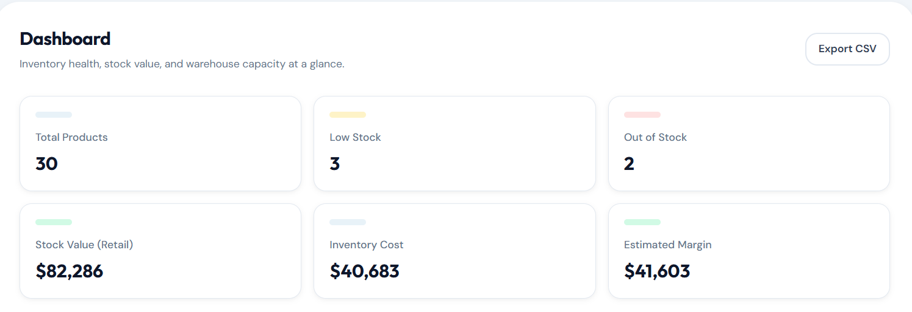
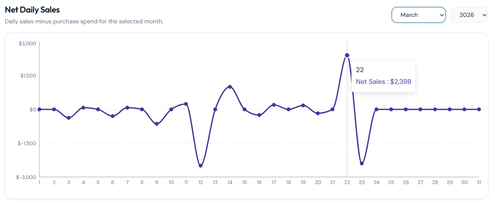
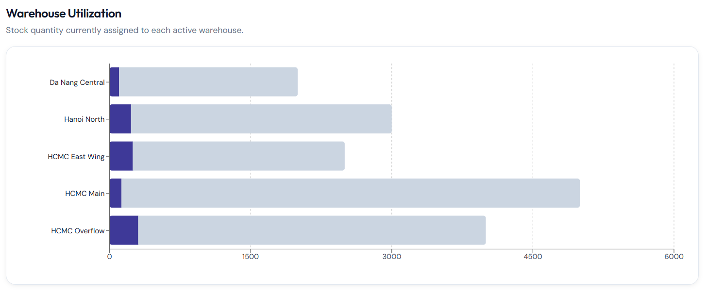

### Products
- Full CRUD operations featuring a soft-delete architecture
- Multipart image upload support (JPEG/PNG/WEBP, 5MB max)
- Auto-generated SKUs, reorder threshold alerts, and out-of-stock indicators
- Advanced search, multi-parameter filtering, pagination, and CSV export
- Complex supplier relationship management (unit costs, preferred vendors)
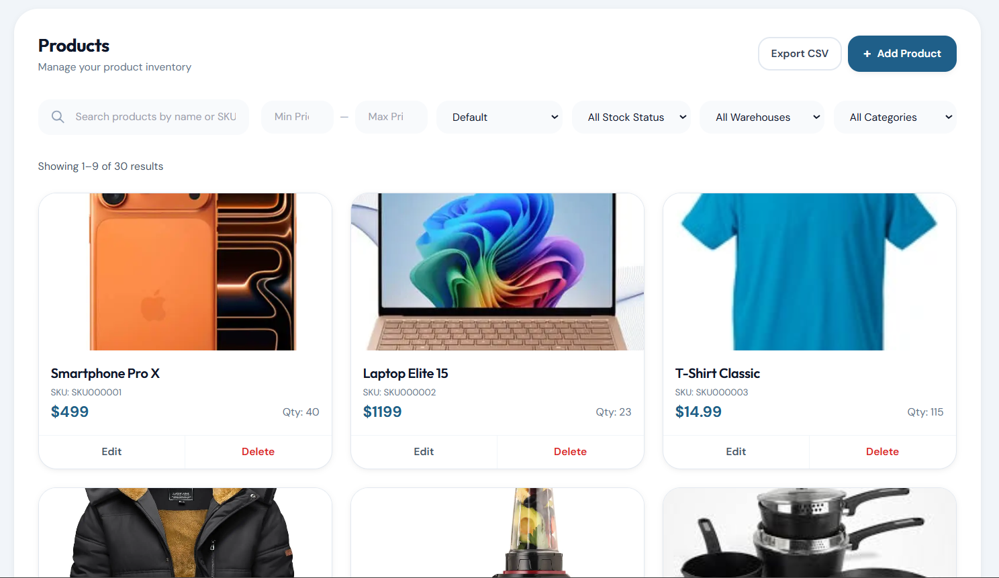
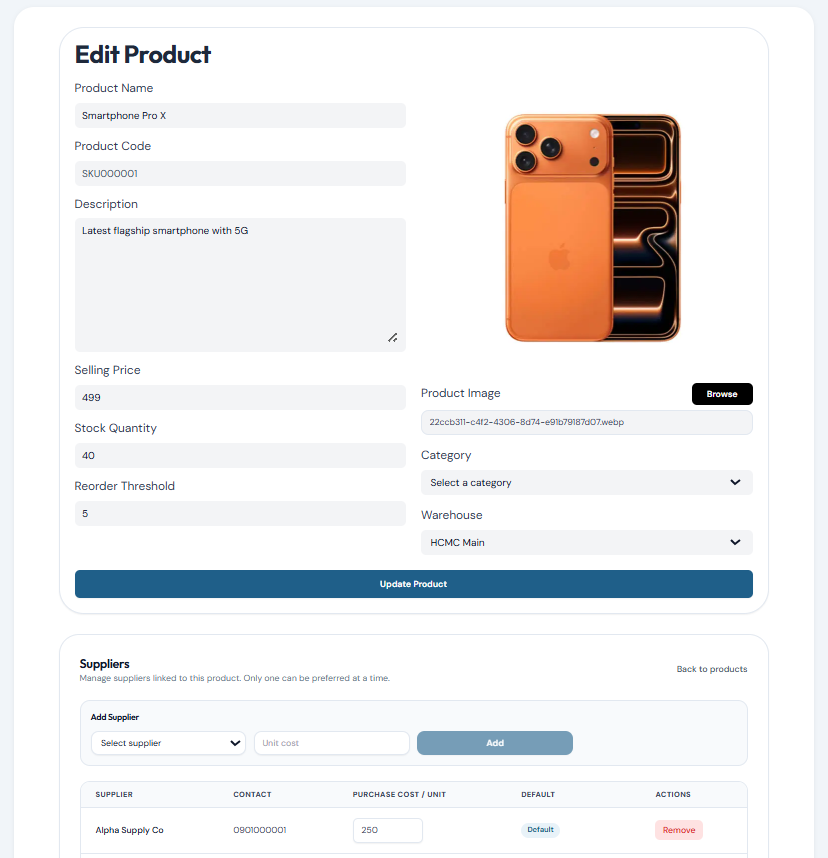

### Transactions
- Distinct Purchase (receive), Sell (deduct), and Return workflows
- Built-in overselling protection to prevent negative inventory balances
- Staff-initiated transactions automatically generate pending proposals for Manager review
- Comprehensive transaction history log with dynamic sorting, status filtering, and CSV export
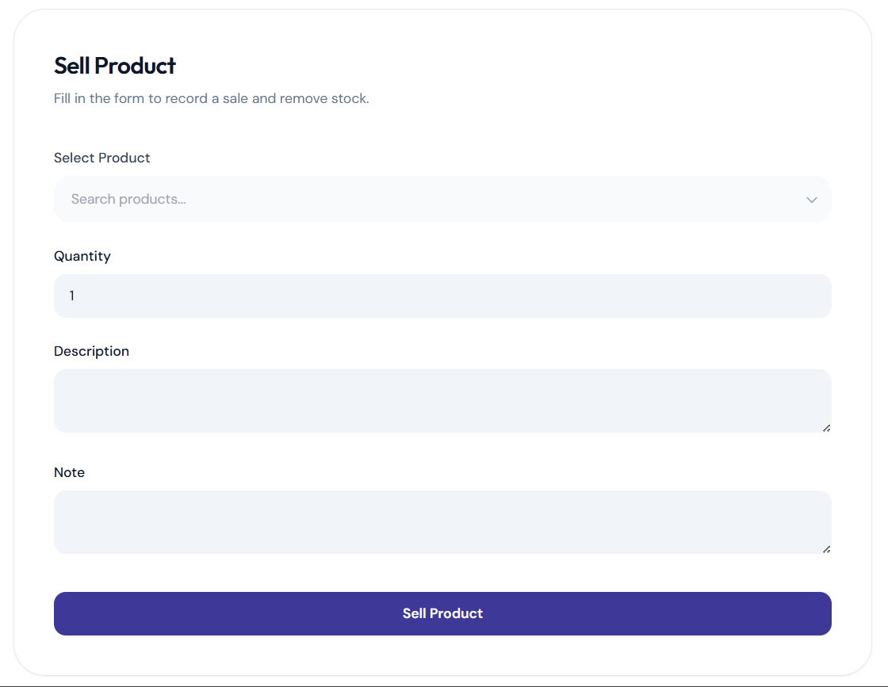
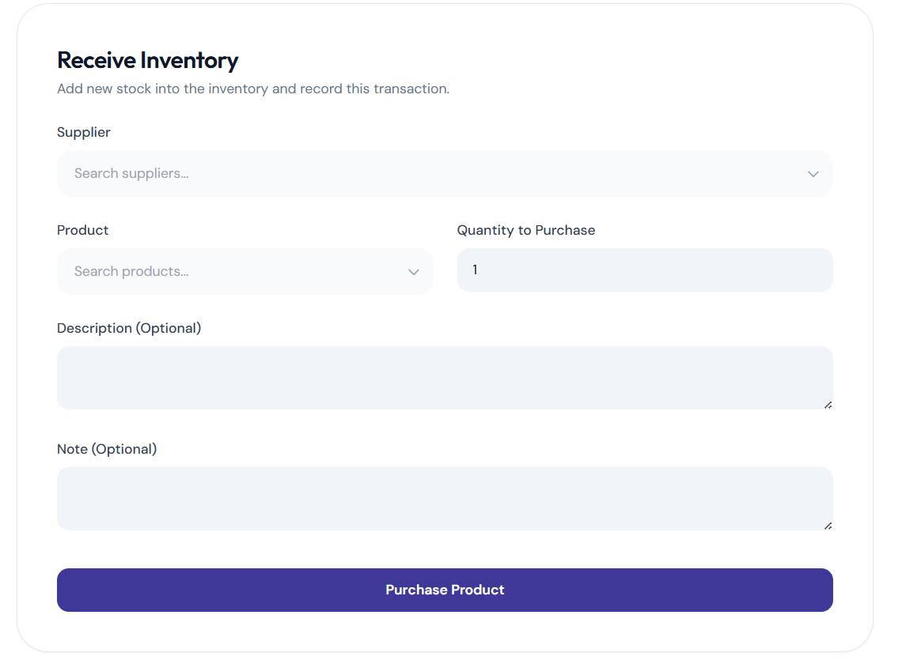
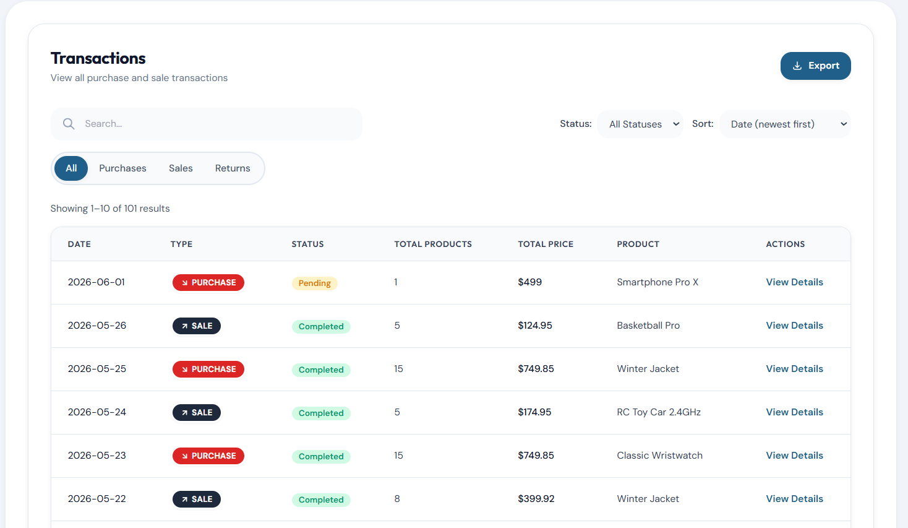
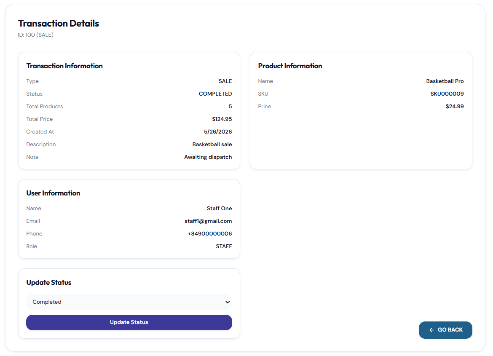

### Suppliers, Categories, and Warehouses
- Centralized master data management with active/inactive status toggling
- Rich metadata tracking (tax codes, warehouse capacities, site managers)
- Dynamic relational linking
- Universal CSV export capabilities across all master data tables
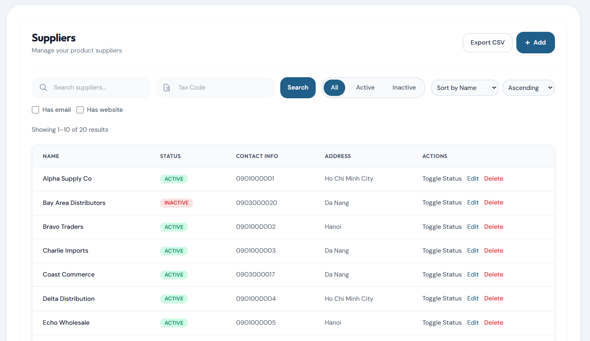
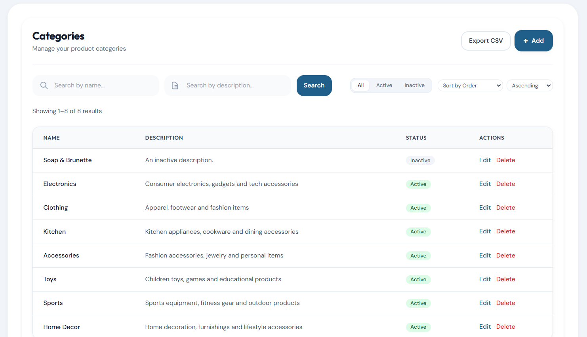
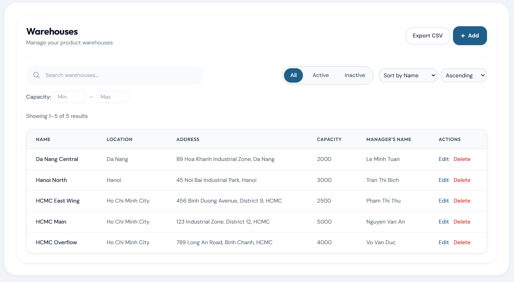

### Users and Access Control
- Secure JWT authentication with BCrypt password hashing
- Strict Role-Based Access Control (RBAC): `ADMIN`, `MANAGER`, and `STAFF`
- Frontend route protection and backend method-level security
- Centralized Admin dashboard for user provisioning and role assignment
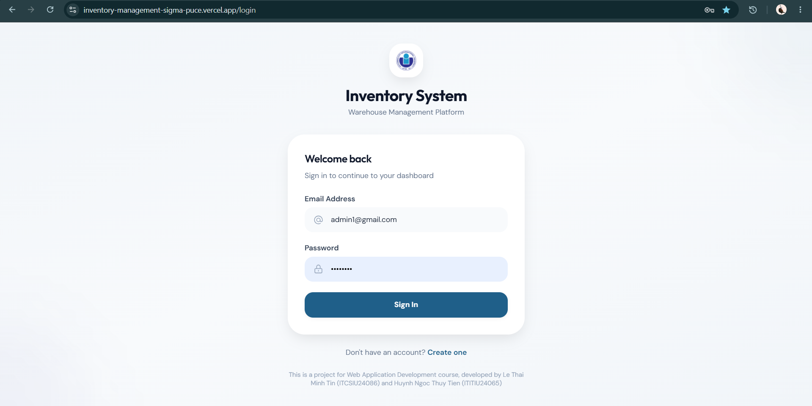
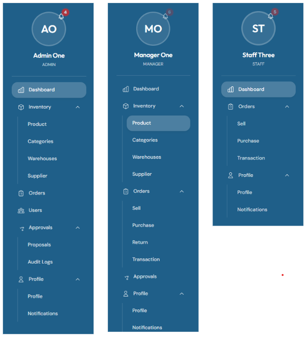
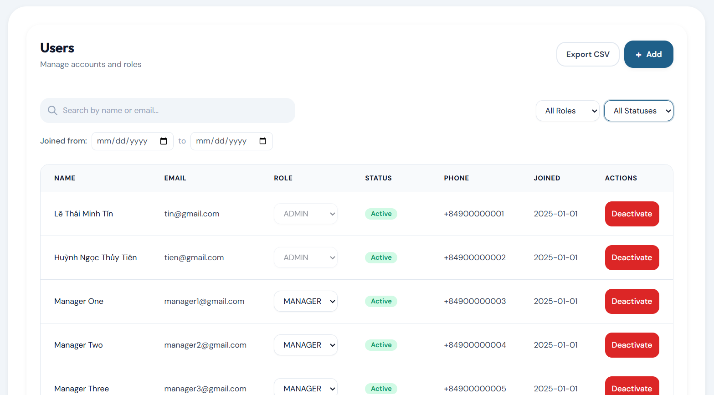

### Proposals, Notifications, and Audit Logs
- Streamlined approval/rejection workflow for staff-submitted inventory actions
- Role-aware system notifications with unread counts
- Deep-dive administrative audit logs capturing exact user actions, timestamps, and payload details
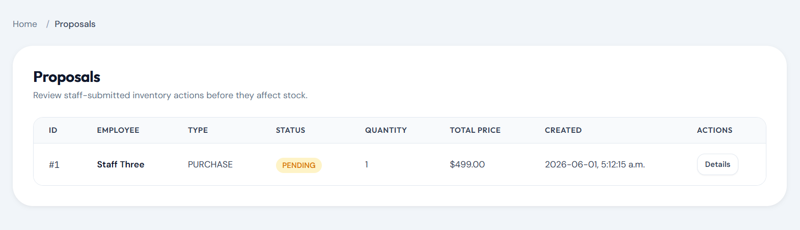
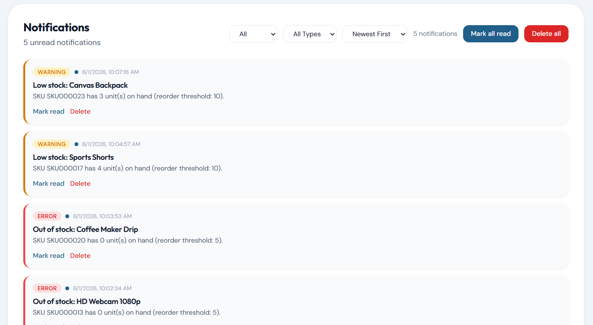
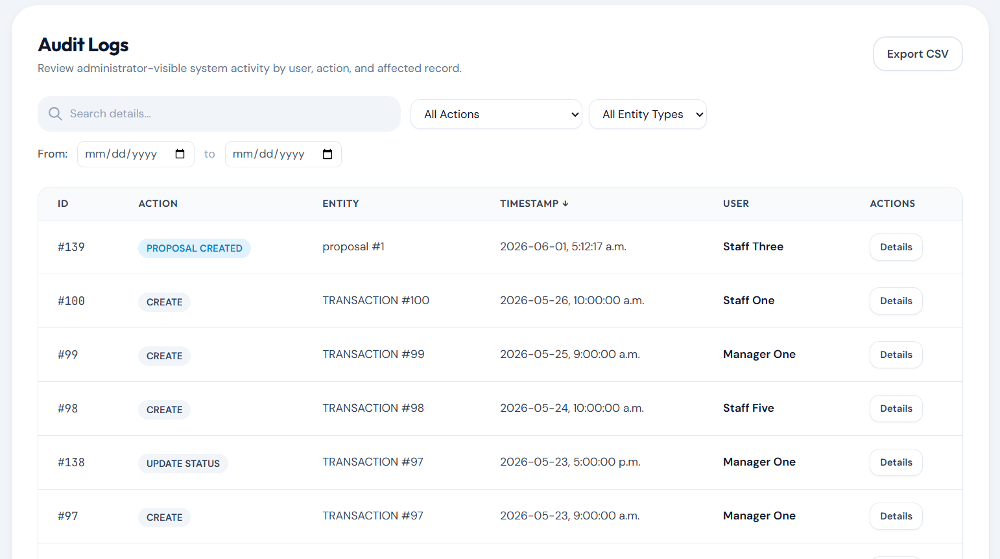

---

## Google Cloud Platform (GCP) Deployment Guide

> [!IMPORTANT]
> **Billing & Project Security Note:**
> Anyone deploying this system to Google Cloud **must use their own Google Cloud account, project, and billing**. 
> - Replace `<YOUR_GCP_PROJECT_ID>` with your own personal GCP project ID.
> - Never commit service account keys (`credentials.json`), OAuth client secrets, or private keys to the repository.
> - Cluster creation and compute resources will always be billed to the GCP account authenticated on the host machine running `gcloud auth login`.

### 1. Prerequisites
- Personal Google Cloud account with an active project (e.g., `<YOUR_GCP_PROJECT_ID>`)
- Google Cloud SDK (`gcloud`) installed
- `kubectl` installed
- Docker installed and running

### 2. Configure GCP Authentication & Project
```powershell
# Authenticate with YOUR OWN Google Cloud account
gcloud auth login

# Set YOUR active project ID (Replace <YOUR_GCP_PROJECT_ID> with your project ID)
$PROJECT_ID = "<YOUR_GCP_PROJECT_ID>"
gcloud config set project $PROJECT_ID
gcloud auth configure-docker asia-southeast1-docker.pkg.dev
```

### 3. Create Artifact Registry & GKE Cluster
```powershell
# Create Docker repository in Artifact Registry
gcloud artifacts repositories create ims-repo `
    --repository-format=docker `
    --location=asia-southeast1 `
    --description="IMS Docker Images"

# Provision a 1-worker node cluster in your own project
gcloud container clusters create ims-cluster `
    --zone=asia-southeast1-a `
    --num-nodes=1 `
    --machine-type=e2-standard-2 `
    --disk-size=30GB

# Connect kubectl to your cluster
gcloud container clusters get-credentials ims-cluster --zone=asia-southeast1-a
```

### 4. Build and Push Container Images
```powershell
$PROJECT_ID = (gcloud config get-value project)
$REGISTRY = "asia-southeast1-docker.pkg.dev/$PROJECT_ID/ims-repo"

# Backend
docker build -t "$REGISTRY/ims-backend:v1" ./Backend
docker push "$REGISTRY/ims-backend:v1"

# Frontend
docker build -t "$REGISTRY/ims-frontend:v1" --build-arg REACT_APP_API_BASE_URL=/api ./frontend
docker push "$REGISTRY/ims-frontend:v1"
```

### 5. Deploy to Kubernetes
Update image references in `k8s/04-backend.yaml` and `k8s/05-frontend.yaml` to match `$REGISTRY` with your own project ID, then apply:
```powershell
# 1. Namespaces, Secrets & Config
kubectl apply -f k8s/00-namespace.yaml
kubectl apply -f k8s/01-secrets.yaml
kubectl apply -f k8s/02-configmaps.yaml

# 2. Database Init ConfigMap
kubectl create configmap mysql-init `
  --from-file="01-init.sql=database/inventory_db.sql" `
  --namespace=ims `
  --dry-run=client -o yaml | kubectl apply -f -

# 3. Deploy Workloads (MySQL -> Backend -> Frontend)
kubectl apply -f k8s/03-mysql.yaml
kubectl apply -f k8s/04-backend.yaml
kubectl apply -f k8s/05-frontend.yaml
```
  --namespace=ims `
  --dry-run=client -o yaml | kubectl apply -f -

# 3. Deploy Workloads (MySQL -> Backend -> Frontend)
kubectl apply -f k8s/03-mysql.yaml
kubectl apply -f k8s/04-backend.yaml
kubectl apply -f k8s/05-frontend.yaml
```

### 6. Verify and Access Application
```powershell
# Check status of pods and services
kubectl get pods,svc,pvc -n ims

# Retrieve the public External IP of the Load Balancer
kubectl get svc frontend -n ims -w
```
Open your browser and navigate to:
```text
http://<EXTERNAL-IP>
```

---

## Cluster Lifecycle & Cost Management

To avoid burning cloud credits when the application is not actively being tested, use the following operational procedures:

### Stop Application (Save Costs)
```powershell
# Option A: Scale all pods to 0 (Keep worker node running)
kubectl scale deployment/backend deployment/frontend --replicas=0 -n ims
kubectl scale statefulset/mysql --replicas=0 -n ims

# Option B: Scale worker VM to 0 nodes (Maximum cost savings without losing configuration)
gcloud container clusters resize ims-cluster --node-pool default-pool --num-nodes 0 --zone asia-southeast1-a --quiet
```

### Resume Application
```powershell
# 1. Scale worker node back to 1
gcloud container clusters resize ims-cluster --node-pool default-pool --num-nodes 1 --zone asia-southeast1-a --quiet

# 2. Scale workloads back up
kubectl scale statefulset/mysql --replicas=1 -n ims
kubectl scale deployment/backend deployment/frontend --replicas=1 -n ims
```

### Complete Teardown
```powershell
gcloud container clusters delete ims-cluster --zone=asia-southeast1-a --quiet
```

---

## Local Development (Alternative)

If you need to run the application locally without cloud resources, a local multi-node cluster (`kind`) automation script is provided:

```powershell
powershell -ExecutionPolicy Bypass -File deploy-k8s.ps1
```
Local URLs:
- Frontend: `http://localhost:30000`
- Backend / Swagger: `http://localhost:30050/swagger-ui/index.html`

---

## License

This project was developed for educational purposes as part of the **System & Network Administration** course at HCMIU.
